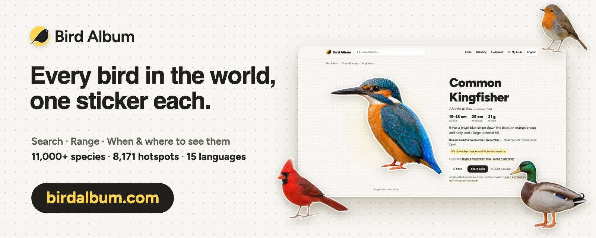

# Adesivos das espécies de aves vivas do mundo


[English](README.md) · [简体中文](README.zh-Hans.md) · [繁體中文](README.zh-Hant.md) · [日本語](README.ja.md) · [한국어](README.ko.md) · [Español](README.es.md) · [Français](README.fr.md) · [Deutsch](README.de.md) · **Português** · [Русский](README.ru.md) · [العربية](README.ar.md)

<a href="https://birdalbum.com/pt-br/?utm_source=github&utm_medium=readme&utm_campaign=bird-sticker"></a>

**Veja a biblioteca inteira em uso em [birdalbum.com](https://birdalbum.com/pt-br/?utm_source=github&utm_medium=readme&utm_campaign=bird-sticker).** O Bird Album é um guia de aves gratuito feito com estes adesivos: procure qualquer espécie pelo nome em 15 idiomas, veja onde ela vive e em quais meses aparece, e abra um mapa com 8.171 pontos de observação de aves que mostra o que as pessoas estão vendo em cada um neste mês.

Mais de 11.000 espécies de aves em 45 ordens e 249 famílias, segundo a [AviList v2026](https://www.avilist.org/), a lista global unificada publicada pela primeira vez em 2025 (a lista do IOC foi encerrada em favor dela). Todas as espécies que a AviList não marca como extintas ou possivelmente extintas estão incluídas, além de 43 espécies marcadas que já tinham adesivo: extintas, extintas na natureza, possivelmente extintas ou, em dois casos, outrora extintas na natureza e depois reintroduzidas (veja `extinctionStatus`). Todas as espécies têm adesivo. Cada espécie vem com dados estruturados: taxonomia, nomes em até 43 idiomas, IDs em outras bases de dados e a partir de que cada adesivo foi gerado.

> **A versão 2.0 passou a taxonomia do IOC 15.2 para a AviList v2026.** 82 espécies mudaram de nome científico (e, com ele, de `id` e de caminho do adesivo), 91 antigas espécies agora são subespécies de outra espécie e 30 espécies novas foram separadas. Todas as mudanças estão listadas em [`data/crosswalk-ioc15.2-avilist2026.csv`](data/crosswalk-ioc15.2-avilist2026.csv), e cada registro guarda o antigo ID do IOC em `previous`. Veja o [CHANGELOG](CHANGELOG.md).


**Gerados por IA, e cada arquivo informa isso.** Os metadados XMP/IPTC de cada adesivo indicam que se trata de uma ilustração gerada por IA, e não de uma fotografia (tipo de fonte digital IPTC `trainedAlgorithmicMedia`), o sistema de IA utilizado, que ela não foi verificada por especialistas e pode conter erros, a licença e um link para este repositório.

**Licença em resumo:** os adesivos estão sob a licença [CC BY 4.0](LICENSE.md): você pode usá-los para qualquer fim, inclusive comercial, e também editá-los e redistribuí-los, desde que cite huashu-bird-sticker com um link para este repositório. Os dados são MIT, e as partes de terceiros estão listadas no [NOTICE](NOTICE.md).

## Usar um adesivo em uma linha

Todos os adesivos são servidos pela CDN jsDelivr (com CORS), então você pode colocá-los direto numa página:

```html

```

Para achar uma ave pelo nome, carregue [`data/stickers.json`](data/stickers.json) (2,7 MB: nome científico, inglês e chinês, caminho do arquivo e a página da espécie em birdalbum.com para cada espécie; os 91 adesivos de subespécies estão em `forms`, em `data/species.json`). Os nomes em 43 idiomas estão em [`data/names.csv`](data/names.csv).

```js
const idx = await (await fetch("https://cdn.jsdelivr.net/gh/alchaincyf/huashu-bird-sticker@main/data/stickers.json")).json();
const s = idx.stickers.find(x => x.en === "Eurasian Magpie");
const url = idx.cdn + s.file;  // URL do adesivo
```

Dê o crédito ao lado da imagem assim, com o link para a página da espécie:

`Illustration: [Bird Album](https://birdalbum.com/birds/common-kingfisher/) / [huashu-bird-sticker](https://github.com/alchaincyf/huashu-bird-sticker), CC BY 4.0`

## Ave do dia

Uma ave diferente por dia no seu perfil do GitHub, blog ou Notion. Cole esta linha em qualquer Markdown (`?lang=` para 15 idiomas, `?theme=dark` ou `auto`):

```markdown
[](https://birdalbum.com/today/?lang=pt-BR)
```

[](https://birdalbum.com/today/?lang=pt-BR)

## Galeria

Dezoito dos grupos mais coloridos e característicos, 24 adesivos de cada um, escolhidos para que não haja dois parecidos. Todos os adesivos mostrados aqui atingem o padrão de qualidade.

### Beija-flores · *Trochilidae* — 361 espécies


### Papagaios e cacatuas · *Psittaciformes* — 391 espécies


### Martins-pescadores · *Alcedinidae* — 123 espécies


### Abelharucos, rolieiros e udus · *Meropidae* · *Coraciidae* · *Brachypteraciidae* · *Momotidae* · *Todidae* — 69 espécies


### Tucanos e barbetas · *Ramphastidae* · *Capitonidae* · *Semnornithidae* · *Megalaimidae* · *Lybiidae* — 132 espécies


### Aves-do-paraíso e jardineiros · *Paradisaeidae* · *Ptilonorhynchidae* — 67 espécies


### Pitas · *Pittidae* — 46 espécies


### Tangarás e sanhaços · *Thraupidae* — 392 espécies


### Suimangas e pica-flores · *Nectariniidae* · *Dicaeidae* — 207 espécies


### Cotingas e manaquins · *Cotingidae* · *Pipridae* — 120 espécies


### Faisões e perdizes · *Phasianidae* — 185 espécies


### Patos, gansos e cisnes · *Anatidae* — 164 espécies


### Pombos e rolas · *Columbidae* — 338 espécies


### Estrildídeos · *Estrildidae* — 138 espécies


### Gaios e pegas · *Corvidae* — 135 espécies


### Icterídeos do Novo Mundo (xexéus, japins e corrupiões) · *Icteridae* — 107 espécies


### Calaus · *Bucerotidae* — 64 espécies


### Estorninhos e mainás · *Sturnidae* — 118 espécies


### Um de cada ordem


## O que há aqui

| | |
|---|---|
| `stickers/<Order>/<Family>/<Genus_species>.webp` | Um adesivo transparente com contorno branco por espécie, com cerca de 1.000 px no lado maior. Os arquivos `<Genus_species>.<subspecies>.webp` são 91 adesivos extras de subespécies que antes eram espécies separadas |
| `data/species.json` | Um registro por espécie, o conjunto de dados completo: taxonomia, nomes, IDs, distribuição e subespécies, medidas corporais e ecologia, estado de conservação, adesivo e sua origem. Descrição dos campos: [data/README.md](data/README.md) |
| `data/crosswalk-ioc15.2-avilist2026.csv` | Como cada espécie do IOC 15.2 corresponde à AviList v2026: igual, renomeada, agrupada, dividida |
| `data/species.csv` | O mesmo conteúdo, achatado para planilhas |
| `data/names.csv` | Nomes em 43 idiomas (46 colunas: chinês, francês e português têm duas variantes cada) |
| `data/languages.json` | Códigos de idioma e a coluna da lista multilíngue do IOC de onde cada um vem |
| `data/field-guide.zh-Hans.json` | Notas de guia de campo em chinês simplificado (aparência, marcas de campo, sexos e idades, espécies semelhantes) para 1.596 espécies, CC BY-SA 4.0 |

Um registro tem este formato (nomes abreviados):

```json
{
  "id": "Accipiter_nisus",
  "scientificName": "Accipiter nisus",
  "authority": "(Linnaeus, 1758)",
  "taxonomy": {"system": "AviList v2026", "seq": 3097, "order": "Accipitriformes", "family": "Accipitridae", "genus": "Accipiter"},
  "names": {"en": "Eurasian Sparrowhawk", "zh-Hans": "雀鹰", "ja": "ハイタカ", "es": "Gavilán común", "fr": "Épervier d'Europe", "…": "…"},
  "ids": {"ebird": "eurspa1", "avibase": "avibase-DB376A66", "wikidata": "Q25380", "gbif": "2480637", "inaturalist": 5106},
  "range": {"text": "lowland to treeline montane forest, open woodland, and urban and suburban parks, from Europe eastward to …", "…": "…"},
  "subspecies": [{"name": "nisus", "authority": "(Linnaeus, 1758)", "range": "breeds Europe to Türkiye and Siberia; winters to Africa"}, "…"],
  "traits": {"massG": 220.8, "wingMm": 207.4, "tailMm": 155.5, "habitat": "Forest", "migration": "partially migratory", "trophicNiche": "Vertivore", "…": "…"},
  "conservation": {"iucn": "LC", "cites": "II", "chinaProtection": "Class II"},
  "taxonConcept": "same",
  "sticker": {
    "file": "stickers/Accipitriformes/Accipitridae/Accipiter_nisus.webp",
    "kind": "ai-illustration",
    "reviewScore": 91,
    "meetsQualityBar": true,
    "license": "CC-BY-4.0",
    "reference": {"type": "photo", "page": "https://commons.wikimedia.org/wiki/File:…", "author": "Dion Art", "license": "CC BY-SA 4.0"}
  }
}
```

## Cobertura

- Nomes: o inglês (AviList) cobre todas as espécies. Os outros idiomas vêm da lista multilíngue do IOC e foram mantidos apenas onde o conceito da espécie não mudou; nas 129 espécies cujos limites mudaram (agrupamentos e divisões) ou que são novas, um nome antigo pode se referir a outro conjunto de aves, então preferimos omiti-lo a adivinhar. O chinês simplificado cobre 10.947 espécies (cada espécie alterada foi conferida à mão); francês, espanhol, alemão, russo, japonês e chinês tradicional passam de 94%. Coreano, árabe, tailandês, persa e alguns outros cobrem de algumas centenas a cerca de mil espécies, porque é isso que a lista do IOC oferece. Veja `data/names.csv`.
- Os nomes em português do Brasil (coluna `pt-x-lusophone` do IOC) cobrem 10.857 das 11.011 espécies.
- IDs: eBird 10.983 e Avibase 11.011, ambos vindos da AviList; Wikidata 10.757, GBIF 10.477.
- Adesivos: todas as 11.011 espécies, mais 91 adesivos de subespécies, 11.102 arquivos no total.

## Como os adesivos foram feitos e qual é a qualidade

Todos os 11.102 arquivos de adesivo são ilustrações feitas por IA. Para cada espécie, procuramos fotos de referência (desde novembro de 2026, quando conseguimos encontrá-las, uma prancha com fotos de vários fotógrafos), desenhamos o adesivo com o GPT-image, ampliamos e recortamos. Para quem quer fazer algo parecido, os prompts, as regras de pose e os critérios de revisão estão em [docs/how-the-stickers-are-made.md](docs/how-the-stickers-are-made.md) (em inglês).

Depois, cada adesivo recebeu a nota de um revisor de IA independente. Em novembro de 2026, reavaliamos todos os adesivos com um critério mais rigoroso, como pranchas de guia de campo: um adesivo só passa na revisão se identificação, plumagem, bico e olho, pernas e pés, e proporções receberem pelo menos 3 pontos de 4 em cada item, a identificação receber 4 e o revisor o aceitar como prancha de guia de campo. 77 adesivos passaram como estavam; os outros 11.025 foram gerados de novo até que uma nova versão passasse.

- **Todos os 11.102 atingem nosso padrão de qualidade** (`"meetsQualityBar": true`): todos passaram pela revisão mais rigorosa descrita acima. O revisor é uma IA, não um especialista em aves, então passar não significa que o adesivo não tenha erros; veja a [issue #1](../../issues/1) e a [issue #3](../../issues/3) para conhecer os tipos de erro que observadores de aves encontraram.
- **Alguns foram gerados só a partir de uma descrição escrita**, sem foto de referência (`"reference": null` em `data/species.json`; o número está em [data/README.md](data/README.md#reference-photos)). Eles têm mais chance de conter erros do que os adesivos conferidos com uma foto. No [birdalbum.com](https://birdalbum.com/), a página da espécie traz um aviso extra para esses adesivos.

São ilustrações, não pranchas de guia de campo. Veja-as como um desenho simpático da ave e consulte um guia de campo antes de confiar em algum detalhe fino. Se encontrar um erro, [abra uma issue](../../issues/new/choose): correções de observadores de aves são a contribuição mais valiosa que este projeto pode receber.

**Conhece bem um grupo de aves?** [Revise uma família](../../issues/new?template=family-review.yml) e diga quais stickers estão errados. Cada um que você apontar é gerado de novo e revisado, e seu nome entra em [CONTRIBUTORS.md](CONTRIBUTORS.md).

## Sobre as fotos de referência

**Para que serve uma referência.** Um adesivo mostra como é uma espécie: as cores e os padrões da plumagem, o bico, o olho, as pernas e os pés, e as proporções. São fatos sobre a ave, as mesmas coisas que um guia de campo descreve em palavras. Uma descrição escrita sozinha muitas vezes não basta para o modelo de imagem acertá-las, então usamos fotos de referência.

**Como usamos.** Para cada espécie, o modelo de imagem vê uma ou mais fotos de referência junto com uma descrição escrita das marcas de identificação e desenha uma ilustração nova. O modo como as fotos foram usadas depende de quando o adesivo foi feito. Os adesivos antigos, gerados antes de novembro de 2026, usaram uma foto por espécie, e tanto a aparência da ave quanto a sua pose nessa foto serviram de referência. Desde novembro de 2026, as fotos servem só para conferir como a ave é; não usamos a pose, a composição, o fundo nem a iluminação da foto. Cada ave é desenhada numa pose padrão definida por nós, sobre um fundo liso (em pé e de perfil na maioria dos grupos; aves que nadam, aves em voo e alguns outros grupos têm poses próprias). Quando conseguimos encontrá-las, as fotos vêm de vários fotógrafos, para que o adesivo reflita a espécie e não uma única imagem (6.369 adesivos foram feitos com uma prancha de várias imagens). Desde então, todos os adesivos antigos, exceto 77, foram gerados de novo dessa forma; esses 77 passaram na revisão mais rigorosa como estavam. Depois, um revisor separado confere o desenho com base nas marcas de identificação. Este repositório não inclui nenhuma foto de referência.

**Créditos e remoção.** As fotos de referência que registramos para cada adesivo (página e, quando conhecidos, autor e licença) estão listadas em `sticker.reference`, em `data/species.json`; os adesivos gerados só a partir de uma descrição escrita têm `"reference": null`. Um detalhamento por licença das fotos de referência está em [data/README.md](data/README.md#reference-photos). Se uma foto sua foi usada como referência e você prefere que não seja assim, [envie um pedido de remoção](../../issues/new?template=takedown.yml), e substituiremos o adesivo em até 7 dias.

## Como usar

Os arquivos podem ser carregados diretamente:

```
https://raw.githubusercontent.com/alchaincyf/huashu-bird-sticker/main/stickers/Accipitriformes/Accipitridae/Accipiter_nisus.webp
```

```python
import json
species = json.load(open("data/species.json"))["species"]
by_name = {s["scientificName"]: s for s in species}
print(by_name["Pica pica"]["names"]["ja"], by_name["Pica pica"]["sticker"]["file"])
```

O repositório tem cerca de 700 MB. Para baixar apenas os dados e alguns adesivos:

```bash
git clone --filter=blob:none --sparse https://github.com/alchaincyf/huashu-bird-sticker
cd huashu-bird-sticker && git sparse-checkout set data stickers/Strigiformes
```

## Quem usa

- [水杉输入法 MSIME](https://github.com/metasequoiaime/msime): um método de entrada de chinês multiplataforma; o dicionário de nomes de aves é gerado a partir de `data/species.json`.
- [Everybird](https://github.com/yusuftaleb/everybird-stickers), de Yusuf Taleb: os stickers, reduzidos e nomeados pelo código do eBird.
- Listado em [Awesome Public Datasets](https://github.com/awesomedata/apd-core), na categoria Biology.

Usa em algum lugar? Abra uma issue e adicionamos você aqui.

## Créditos

- Taxonomia, nomes em inglês, distribuição e IDs do eBird e do Avibase: AviList Core Team. 2026. AviList: The Global Avian Checklist, v2026. https://doi.org/10.2173/avilist.v2026, CC BY 4.0.
- Nomes em outros idiomas: IOC World Bird List v15.2, Gill, Donsker & Rasmussen (orgs.), CC BY 3.0.
- Demais IDs entre bases de dados: Wikidata (CC0).
- Medidas corporais e ecologia: AVONET, Tobias et al., 2022, *Ecology Letters*, CC BY 4.0.
- Fotógrafos das imagens de referência: creditados por espécie em `data/species.json`. As fotos de referência não estão incluídas neste repositório.
- Adesivos desenhados para o 鸣迹 (Mingji), um caderno de observação de aves para iOS.

Se uma foto sua foi usada como referência para um adesivo e você prefere que não seja assim, [envie um pedido de remoção](../../issues/new?template=takedown.yml), e substituiremos o adesivo em até 7 dias.
