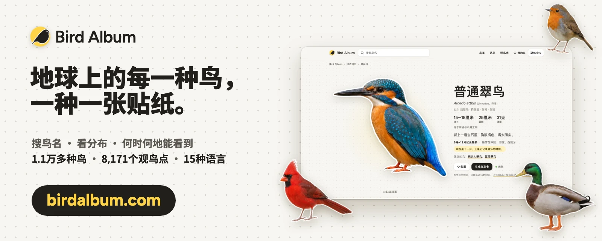

# 花叔开源：全球鸟类贴纸库


[English](README.md) · **简体中文** · [繁體中文](README.zh-Hant.md) · [日本語](README.ja.md) · [한국어](README.ko.md) · [Español](README.es.md) · [Français](README.fr.md) · [Deutsch](README.de.md) · [Português](README.pt.md) · [Русский](README.ru.md) · [العربية](README.ar.md)

<a href="https://birdalbum.com/zh/?utm_source=github&utm_medium=readme&utm_campaign=bird-sticker"></a>

**这套贴纸的完整用法，去[birdalbum.com](https://birdalbum.com/zh/?utm_source=github&utm_medium=readme&utm_campaign=bird-sticker)看。** Bird Album是用这个贴纸库做的免费鸟类网站：15种语言都能搜鸟名，看每种鸟分布在哪、几月能见到；地图上有8,171个观鸟点，每处都列出这个月大家常记录的鸟。

[花叔](https://github.com/alchaincyf)开源的全球鸟类贴纸库，贴纸出自花叔做的观鸟App「鸣迹」。按全球统一鸟类名录[AviList v2026](https://www.avilist.org/)整理，共1.1万多种鸟、45目249科。AviList是2025年首次发布的全球统一名录（IOC名录已停止更新，转而采用它）。AviList没有标为灭绝或可能灭绝的种全部收录；另有43种带灭绝相关标记、已有贴纸的种也保留了：灭绝、野外灭绝、可能灭绝，其中两种曾野外灭绝、现已重新引入（见`extinctionStatus`）。每种鸟都有贴纸。每种鸟都配有结构化数据：分类、最多43种语言的鸟名、各大数据库的编号，以及每张贴纸是依据什么生成的。

> **2.0版把分类从IOC 15.2换成了AviList v2026。** 82种改了学名（`id`和贴纸路径随之改变），91个原独立种现在是别种的亚种，另有30个新种从原有物种中拆出。每一处变化都列在[`data/crosswalk-ioc15.2-avilist2026.csv`](data/crosswalk-ioc15.2-avilist2026.csv)里，每条记录的`previous`保留了旧的IOC编号。详见[更新记录](CHANGELOG.md)。


**AI生成，每个文件里都写明了。** 每个贴纸文件的XMP/IPTC元数据都写着：这是AI生成的插画，不是照片（IPTC数字来源类型`trainedAlgorithmicMedia`），用的是哪个AI系统，没有经过专家核对、可能有错，以及授权和本仓库的链接。

**授权一句话：** 贴纸按[CC BY 4.0](LICENSE.md)授权，可以免费用于任何用途，包括商用、修改和再分发，只要注明来自huashu-bird-sticker并附上仓库链接。数据按MIT授权，第三方部分见[NOTICE](NOTICE.md)。

## 一行代码用上

每张贴纸都能直接从jsDelivr CDN加载（已开跨域），放进网页即可：

```html

```

要按鸟名查贴纸，加载[`data/stickers.json`](data/stickers.json)（2.7 MB，每种一条：学名、英文名、中文名、文件路径和birdalbum.com上的鸟种页；91张亚种贴纸在`data/species.json`的`forms`里）。43种语言的鸟名在[`data/names.csv`](data/names.csv)。

```js
const idx = await (await fetch("https://cdn.jsdelivr.net/gh/alchaincyf/huashu-bird-sticker@main/data/stickers.json")).json();
const s = idx.stickers.find(x => x.zh === "欧亚喜鹊");
const url = idx.cdn + s.file;  // 贴纸网址
```

在图片旁边这样署名，并链接到鸟种页：

`Illustration: [Bird Album](https://birdalbum.com/birds/common-kingfisher/) / [huashu-bird-sticker](https://github.com/alchaincyf/huashu-bird-sticker), CC BY 4.0`

## 每日一鸟

在 GitHub 个人主页、博客或 Notion 里放一张每天换一只的鸟卡片，把这行贴进任意 Markdown（`?lang=` 支持15种语言，`?theme=dark` 或 `auto` 切深色）：

```markdown
[](https://birdalbum.com/zh/today/)
```

[](https://birdalbum.com/zh/today/)

## 画廊

18个最多彩、长相最有特点的类群，每组24张，尽量挑彼此长得不一样的。这里展示的都是达到质量线的贴纸。

### 蜂鸟 · *Trochilidae* — 361种


### 鹦鹉 · *Psittaciformes* — 391种


### 翠鸟 · *Alcedinidae* — 123种


### 蜂虎、佛法僧与翠鴗 · *Meropidae* · *Coraciidae* · *Brachypteraciidae* · *Momotidae* · *Todidae* — 69种


### 巨嘴鸟与拟啄木鸟 · *Ramphastidae* · *Capitonidae* · *Semnornithidae* · *Megalaimidae* · *Lybiidae* — 132种


### 极乐鸟与园丁鸟 · *Paradisaeidae* · *Ptilonorhynchidae* — 67种


### 八色鸫 · *Pittidae* — 46种


### 裸鼻雀 · *Thraupidae* — 392种


### 太阳鸟与啄花鸟 · *Nectariniidae* · *Dicaeidae* — 207种


### 伞鸟与娇鹟 · *Cotingidae* · *Pipridae* — 120种


### 雉鸡 · *Phasianidae* — 185种


### 鸭、雁与天鹅 · *Anatidae* — 164种


### 鸠鸽 · *Columbidae* — 338种


### 梅花雀与文鸟 · *Estrildidae* — 138种


### 鸦科：松鸦与鹊 · *Corvidae* — 135种


### 拟鹂与酋长鹂 · *Icteridae* — 107种


### 犀鸟 · *Bucerotidae* — 64种


### 椋鸟与八哥 · *Sturnidae* — 118种


### 每个目各一只


## 里面有什么

| | |
|---|---|
| `stickers/<目>/<科>/<属_种>.webp` | 每种一张透明底白边贴纸，长边约1000像素。`<属_种>.<亚种>.webp`是91张亚种贴纸，它们原本是独立种 |
| `data/species.json` | 每种一条记录，最完整的数据：分类、鸟名、编号、分布与亚种、形态与生态、保护等级、贴纸及其来历。字段说明见[data/README.md](data/README.md) |
| `data/species.csv` | 同上，摊平成表格，方便用Excel打开 |
| `data/crosswalk-ioc15.2-avilist2026.csv` | IOC 15.2的每个种在AviList v2026里对应什么：不变、改名、并入、拆分 |
| `data/names.csv` | 43种语言的鸟名（46列：中文、法文、葡萄牙文各有两个版本） |
| `data/languages.json` | 语言代码，以及每种语言对应IOC多语种表里的哪一列 |
| `data/field-guide.zh-Hans.json` | 1596种鸟的中文图鉴文字（一句话印象、辨识要点、雌雄幼鸟、相似种、小知识），CC BY-SA 4.0 |

记录的结构见[英文说明](README.md#whats-inside)里的示例。

## 覆盖情况

- 鸟名：英文用AviList的英文名，覆盖全部物种。其他语种来自IOC多语种名录，只在分类范围没变的种上沿用；有129种因为合并、拆分改变了范围或是新种，旧名可能指的是另一群鸟，我们宁可空着也不硬套。简体中文覆盖10947种，范围变了的种逐条人工核过；法文、西班牙文、德文、俄文、日文、繁体中文都超过94%；韩文、阿拉伯文、泰文、波斯文等只有几百到一千来种，因为IOC名录里只有这么多。
- 繁体中文直接取自IOC，中国台湾、中国香港的常用鸟名有时不同，欢迎补充。
- 编号：eBird 10983种、Avibase 11011种，都取自AviList；Wikidata 10757种，GBIF 10477种。
- 贴纸：11011种全部都有，另有91张亚种贴纸，共11102个文件。

## 贴纸怎么来的，质量如何

全部11102个贴纸文件都是AI绘制。每种鸟先找参考照片（2026年11月起，在能找到的情况下，用几位拍摄者的照片拼成参考板），用GPT-image画成贴纸，再放大、抠图。想做类似东西的话，提示词、姿势规范和审核标准都写在[docs/how-the-stickers-are-made.zh-Hans.md](docs/how-the-stickers-are-made.zh-Hans.md)。

每张贴纸生成后，都由另一个AI审核员打分。2026年11月，我们按图鉴图版的更严标准把全部贴纸重新审核了一遍：辨识、羽色与斑纹、喙与眼、腿脚、比例五项评分均至少3分（每项满分4分），辨识项达到4分，且审核员认可其可用作图鉴图版，才算过线。77张原样通过，其余11025张重新生成，直到新版过线为止。

- **全部11102张都达到我们的质量线**（`"meetsQualityBar": true`）：每一张都通过了上述更严审核。审核员是AI，不是鸟类专家，过线不等于没有错；鸟友发现过哪类错误，可以看[issue #1](../../issues/1)和[issue #3](../../issues/3)。
- **少数贴纸只依据文字描述生成**，没有用参考照片（`data/species.json` 里 `"reference": null`，数量见 [data/README.md](data/README.md#reference-photos)）。它们比对照过照片的贴纸更容易画错。在 [birdalbum.com](https://birdalbum.com/) 上，这些贴纸的鸟种页面都会另外提示。

这些是插画，不是图鉴图版。当作一张友好的鸟的画像来用；涉及细节辨识，请以图鉴为准。发现画错了，欢迎[提issue](../../issues/new/choose)。鸟友的纠错，是这个项目最需要的贡献。

**熟悉某一类鸟？**欢迎[帮忙审一个科](../../issues/new?template=family-review.yml)，告诉我们这个科里哪些贴纸画错了。你指出的每一张都会重新生成、重新审核，你的名字会写进 [CONTRIBUTORS.md](CONTRIBUTORS.md)。

## 参考照片

**参考照用来做什么**。一张贴纸要表现的是这种鸟长什么样：羽色与斑纹、喙、眼、腿脚和身体比例。这些是关于这种鸟的事实，也是野外图鉴用文字描述的同一批内容。只靠文字说明，生图模型常常画不准，所以我们使用参考照片。

**我们怎么用参考照**。画每一种鸟时，生图模型会看到一张或几张参考照片和一段辨识特征的文字说明，然后画出一张新的插画。照片怎么用，取决于贴纸是什么时候生成的。2026年11月以前生成的早期贴纸，每种鸟用一张照片，照片里鸟的样貌和姿势都作为参考。2026年11月起，照片只用来核对鸟的样貌，不用照片里的姿势、构图、背景和光线；每只鸟都画成我们定的标准姿势，背景留空（多数类群是站立的正侧面，游水、飞行等少数类群有各自的姿势）。在能找到的情况下，照片来自多位拍摄者（6369张贴纸用了几张图拼成的参考板），让贴纸反映的是这个物种，而不是某一张照片。早期贴纸除77张外都已按这种方式重新生成，这77张在更严审核下原样通过。画完后由另一个审核模型按辨识特征检查。仓库里不含任何参考照片。

**署名与撤下**。我们记录下来的每张贴纸的参考照片（页面，以及已知的作者和许可）写在`data/species.json`的`sticker.reference`里；只凭文字描述生成的贴纸写`"reference": null`。按参考照许可的分类统计见[data/README.md](data/README.md#reference-photos)。如果你的照片被用作参考，而你不希望这样，请[提交撤图申请](../../issues/new?template=takedown.yml)，我们会在7天内替换这张贴纸。

## 怎么用

单张图可以直接引用：

```
https://raw.githubusercontent.com/alchaincyf/huashu-bird-sticker/main/stickers/Accipitriformes/Accipitridae/Accipiter_nisus.webp
```

整个仓库约700MB。只想要数据和某一个目的贴纸，可以这样拉：

```bash
git clone --filter=blob:none --sparse https://github.com/alchaincyf/huashu-bird-sticker
cd huashu-bird-sticker && git sparse-checkout set data stickers/Strigiformes
```

## 谁在用

- [水杉输入法 MSIME](https://github.com/metasequoiaime/msime)：跨平台中文输入法，鸟名词库由 `data/species.json` 生成。
- [Everybird](https://github.com/yusuftaleb/everybird-stickers)（Yusuf Taleb）：把贴纸缩小后按 eBird 代码命名使用。
- 收录于 [Awesome Public Datasets](https://github.com/awesomedata/apd-core) 的 Biology 分类。

你也在用？开个 issue 告诉我们，我们加到这里。

## 致谢

- 分类、英文名、分布、eBird与Avibase编号：AviList Core Team. 2026. AviList: The Global Avian Checklist, v2026. https://doi.org/10.2173/avilist.v2026，CC BY 4.0。
- 其他语种鸟名：IOC世界鸟类名录v15.2，Gill、Donsker与Rasmussen编，CC BY 3.0。
- 其他数据库编号：Wikidata（CC0）。
- 形态与生态数据：AVONET，Tobias等，2022，《Ecology Letters》，CC BY 4.0。
- 参考照片的摄影师：逐种写在`data/species.json`里。参考照片本身不在仓库中。
- 贴纸为观鸟记录App「鸣迹」绘制。

如果你的照片被用作某张贴纸的参考，而你不希望这样，请[提交撤图申请](../../issues/new?template=takedown.yml)，我们会在7天内替换这张贴纸。
